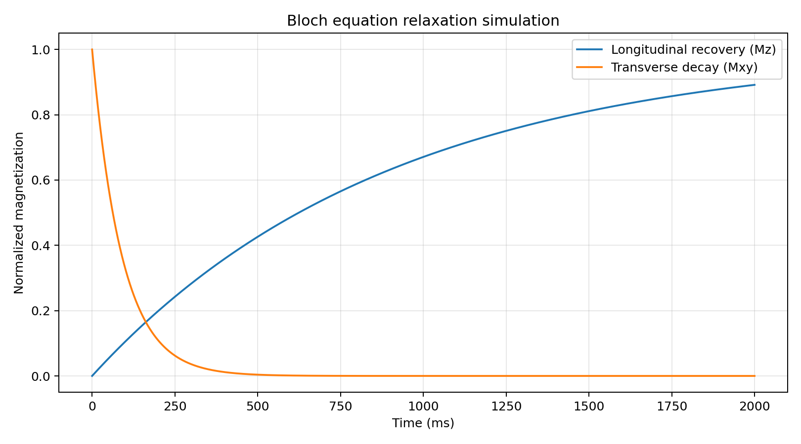

# MRI Physics and Reconstruction

Educational, independently implemented numerical experiments in MRI physics, signal modeling, and image reconstruction. This repository is a learning portfolio, **not** validated clinical software.

## Project 1: Bloch Equation Simulator

A Python implementation of the macroscopic Bloch equations in an **on-resonance rotating frame**, using `scipy.integrate.solve_ivp`.

With no RF field after an ideal 90° excitation, the simulation models:

- Longitudinal recovery: `Mz(t) = M0 * (1 - exp(-t/T1))`
- Transverse decay: `Mxy(t) = M0 * exp(-t/T2)`

The initial magnetization is `(Mx, My, Mz) = (1, 0, 0)`, normalized to equilibrium magnetization `M0 = 1`. The numerical solution is checked against analytical expressions.



## Run locally

From the repository root:

```bash
python -m pip install -r requirements.txt
python 01_Bloch_Equation_Simulation/bloch_simulation.py
python -m pytest -q
```

The simulation saves its plot in `01_Bloch_Equation_Simulation/figures/relaxation.png`.

## Next experiments

- RF pulse dynamics and flip-angle control
- Fourier encoding and k-space reconstruction
- Undersampled and regularized reconstruction
- Quantitative T1/T2 parameter estimation

## Notes

These simulations are simplified teaching models. They omit spatial encoding, off-resonance effects, diffusion, coil sensitivity, and other acquisition complexities.
